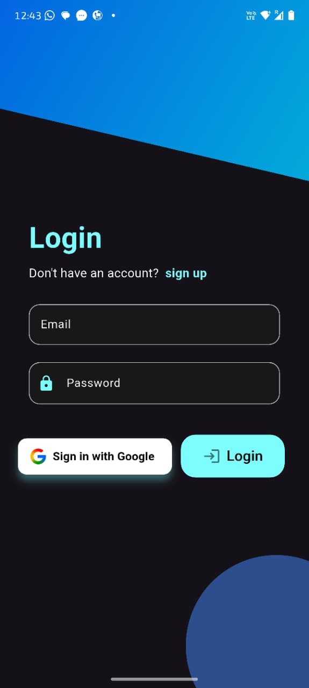
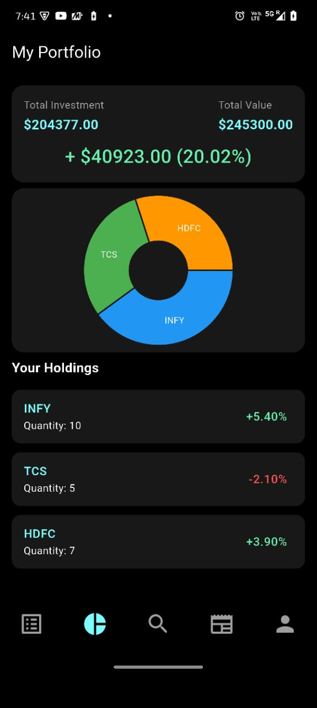
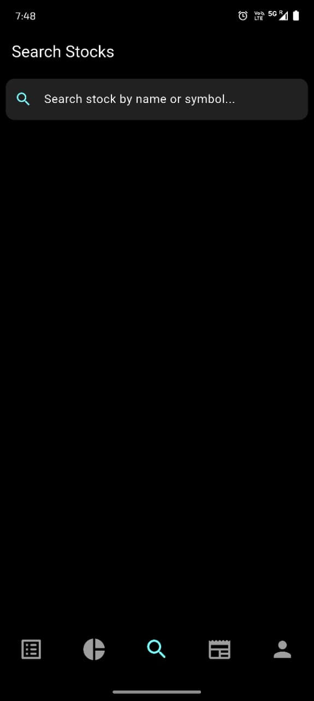
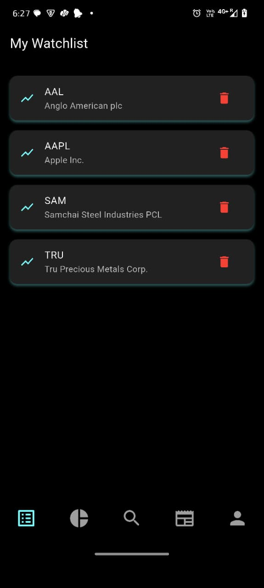
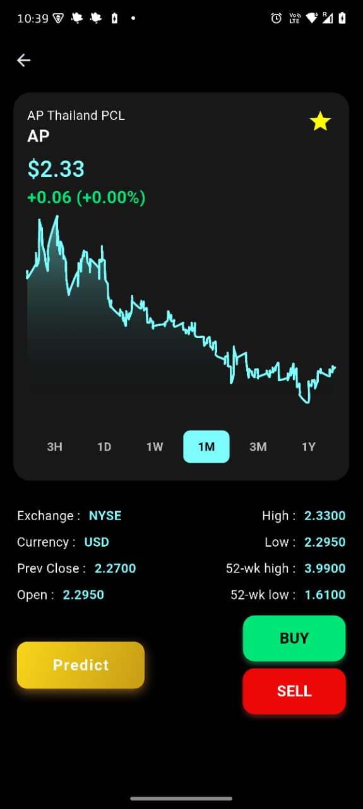
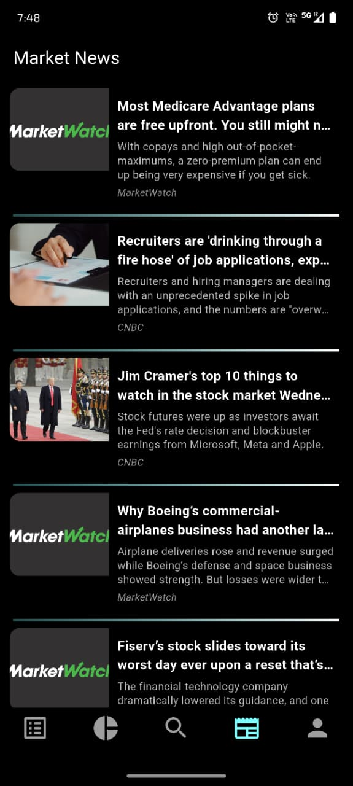

# 📈 Stalk Stocks

A Flutter-based stock market application that allows users to explore stocks, monitor market movements, manage watchlists, track investment portfolios, and stay updated with financial news.

## 📱 Screenshots

| Login | Dashboard | Search |
|:---:|:---:|:---:|
|  |  |  |

| Favorites | Stock Chart | News |
|:---:|:---:|:---:|
|  |  |  |

## ✨ Features

- **User Authentication** – User registration and login using Firebase Authentication and Google Sign-In.
- **Stock Dashboard** – Explore stock market information through a centralized dashboard.
- **Stock Search** – Search and discover stocks.
- **Watchlist Management** – Add and manage favorite stocks for easy access.
- **Stock Charts** – Visualize stock price movements through interactive charts.
- **Portfolio Management** – Track and manage stock investments.
- **Financial News** – Stay updated with financial and market-related news.
- **User Profile** – Manage user account information.

## 🛠️ Tech Stack

| Technology | Purpose |
|---|---|
| Flutter | Cross-platform application development |
| Dart | Programming language |
| GetX | State management and navigation |
| Firebase Authentication | User authentication |
| Google Sign-In | Google authentication |
| Cloud Firestore | Cloud database |
| fl_chart | Interactive chart visualization |
| HTTP | API communication |
| URL Launcher | External links and resources |

## 📂 Project Structure

```text
lib/
├── controllers/
│   ├── auth_controller.dart
│   ├── chart_controller.dart
│   ├── news_controller.dart
│   ├── portfolio_controller.dart
│   ├── search_controller.dart
│   └── watchlist_controller.dart
│
├── screens/
│   ├── login_screen.dart
│   ├── main_screen.dart
│   ├── news_screen.dart
│   ├── portfolio_screen.dart
│   ├── profile_screen.dart
│   ├── search_screen.dart
│   ├── sign_up_screen.dart
│   ├── stock_chart_screen.dart
│   └── watchlist_screen.dart
│
├── services/
│   └── stock_service.dart
│
├── firebase_options.dart
├── main.dart
└── stock_data.dart

assets/
├── ss/
│   ├── dashboard.jpeg
│   ├── fav.jpeg
│   ├── graph.jpeg
│   ├── login.jpeg
│   ├── news.jpeg
│   └── search.jpeg
├── app_icon.jpg
├── google_logo.png
└── profile_placeholder.png
```

## 🚀 Getting Started

### Prerequisites

- Flutter SDK
- Dart SDK
- Android Studio or VS Code
- Firebase project

### Installation

1. Clone the repository:

```bash
git clone https://github.com/TaranSingh-111/Stalk-Stocks.git
```

2. Navigate to the project directory:

```bash
cd Stalk-Stocks
```

3. Install dependencies:

```bash
flutter pub get
```

4. Configure Firebase for your application using FlutterFire CLI.

5. Run the application:

```bash
flutter run
```

## 📦 Dependencies

Major packages used in this project:

- `get`
- `fl_chart`
- `http`
- `firebase_core`
- `firebase_auth`
- `google_sign_in`
- `cloud_firestore`
- `url_launcher`
- `hexcolor`

## 🎯 Project Goals

This project focuses on building a feature-rich stock market application while exploring:

- Cross-platform application development using Flutter.
- State management and navigation using GetX.
- Firebase authentication and cloud database integration.
- Third-party API integration for stock market data.
- Interactive financial data visualization.
- Portfolio and watchlist management.
- Modular application architecture using controllers, screens, and services.

## ⚠️ Disclaimer

This application is intended for educational and informational purposes only. Stock market information should not be considered financial or investment advice.

## 👨‍💻 Author

**Taran Singh**

[GitHub](https://github.com/TaranSingh-111)
